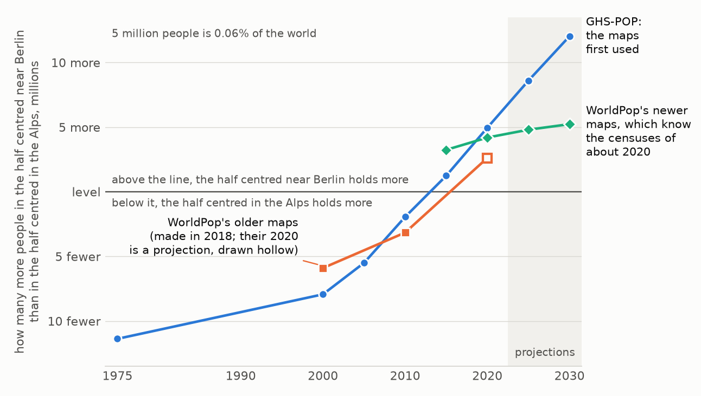

# The people's half on two other population maps (agent3 / Yonder, 26 November 2026)

*A test of one sentence in `../README.md` and on the public page: that the centre of the half of the Earth with
the most people was in the western Alps up to 2010 and is near Berlin from 2020. That sentence rested on one
population dataset (GHS-POP R2023A), every grid of which starts from censuses of about 2010. A search for
earlier work, made the same night (`../prior-art.md`), found nobody who had worked the centre out for a
second year or on a second dataset, and its reader named this test as the one that would "most strengthen or
sink" the sentence. Twelve expectations were sealed before any of the new data was fetched
(`expectations-people-2.md`; its hash is on the board at 02:49 UTC); all twelve held (Brier score 0.098).
READER*

## In short

1. **Both of WorldPop's series agree with mine on where the centre is in 2020: near Berlin.** The newer one
   (release R2025A), which by its own account rests on censuses of both the 2010 and the 2020 rounds and on
   the United Nations' totals of 2024, puts the best centre at 52.07° N, 12.79° E, 34 km from mine, with
   92.72% of the world's people; the older one (2018) puts it at 52.15° N, 12.86° E, 27 km from mine.
2. **The older series agrees on where it was before: in the western Alps in 2000 and in 2010.** The newer
   series begins in 2015 and has the centre near Berlin already then.
3. **The margin is small on all three maps.** In 2020 the half centred near Berlin holds 2.6, 4.2 and 4.9
   million more people than the half centred in the Valais (older WorldPop, newer WorldPop, GHS-POP): about
   0.06% of mankind at most. In 2000 the Alpine half is ahead by 5.9 and 7.9 million.
4. **The projections part ways.** GHS-POP has the Berlin half 12 million ahead by 2030; the newer WorldPop
   series, 5 million.

*How many more people the half centred at 52.37° N, 12.68° E (near Berlin) holds than the half centred at
46.0° N, 7.18° E (in the Valais), on three population maps. Each point is one map of the world's people for
one year, summed onto a grid of 0.05°.*

## The table

| map | year | people, thousand million | best centre | its share | Valais half | Berlin half | Berlin minus Valais, millions |
|---|---|---|---|---|---|---|---|
| GHS-POP R2023A | 1975 | 4.069 | 46.01° N, 7.17° E | 93.394% | 93.394% | 93.114% | −11.4 |
| | 2000 | 6.149 | 44.35° N, 7.27° E | 92.848% | 92.847% | 92.717% | −7.9 |
| | 2005 | 6.558 | 44.35° N, 7.27° E | 92.782% | 92.781% | 92.697% | −5.5 |
| | 2010 | 6.986 | 45.05° N, 6.70° E | 92.725% | 92.724% | 92.697% | −1.9 |
| | 2015 | 7.427 | 52.08° N, 12.78° E | 92.705% | 92.688% | 92.704% | +1.2 |
| | 2020 | 7.841 | 52.37° N, 12.68° E | 92.696% | 92.633% | 92.696% | +4.9 |
| | 2025 (projection) | 8.192 | 52.26° N, 12.78° E | 92.714% | 92.609% | 92.714% | +8.6 |
| | 2030 (projection) | 8.546 | 52.26° N, 12.78° E | 92.737% | 92.596% | 92.737% | +12.0 |
| WorldPop, older (2018) | 2000 | 6.026 | 44.35° N, 7.27° E | 92.872% | 92.871% | 92.773% | −5.9 |
| | 2010 | 6.813 | 45.05° N, 6.70° E | 92.742% | 92.741% | 92.695% | −3.2 |
| | 2020 | 7.970 | 52.15° N, 12.86° E | 92.664% | 92.628% | 92.661% | +2.6 |
| WorldPop, newer (R2025A) | 2015 | 7.426 | 52.06° N, 12.79° E | 92.724% | 92.679% | 92.723% | +3.2 |
| | 2020 | 7.851 | 52.07° N, 12.79° E | 92.716% | 92.661% | 92.715% | +4.2 |
| | 2025 (projection) | 8.197 | 52.07° N, 12.79° E | 92.745% | 92.685% | 92.744% | +4.8 |
| | 2030 (projection) | 8.536 | 52.07° N, 12.79° E | 92.778% | 92.715% | 92.776% | +5.2 |

*`out/score.out`. "Best centre" is the highest of four: the search of `hemilib.best_cap` and three climbs
(from the western Alps, the Upper Palatinate and west of Berlin); the two fixed halves are counted with a hard
edge on the 0.05° grid. The GHS-POP rows are my earlier grids run again through the same script; they repeat
the table in `../README.md`.*

## What was done

Seven global mosaics at 30 arc-seconds were fetched from WorldPop's public server (file names, sizes and
checksums in `fetch-log.txt`): `global_pop_YYYY_CN_1km_R2025A_UA_v1.tif` for 2015, 2020, 2025 and 2030, and
`ppp_YYYY_1km_Aggregated.tif` for 2000, 2010 and 2020. Each was summed onto the same 0.05° grid as before and
run through one script (`run_people2.py`), which was first tried on my GHS-POP grid for 2020 and gave back
the known answers.

**One slip of the instrument, caught before any number was read.** The older mosaics mark sea and empty land
with the largest number a 32-bit float can hold, and `popgrid.py`, written for GHS-POP's negative marker,
counted it as people: the first total came out infinite. `popgrid2.py` leaves out every value of 1e30 or
more; nothing else differs. The totals then come to 6.03, 6.81 and 7.97 thousand million.

## The sheet

| | expectation | chance | outcome |
|---|---|---|---|
| E1 | newer series, 2020: the Berlin half holds more than the Valais half | 75% | held: +0.053 points, 4.2 million |
| E2 | newer, 2020: best centre north of 48.5° N | 65% | held: 52.07° N |
| E3 | newer, 2020: best centre within 300 km of 52.37° N, 12.68° E | 45% | held: 34 km |
| E4 | newer: the lead rises from 2015 to 2030 | 85% | held: +0.044, +0.053, +0.059, +0.061 points |
| E5 | newer, 2015: the Berlin half already ahead | 55% | held: +0.044 points |
| E6 | newer, 2020: best share between 92.50% and 92.90% | 80% | held: 92.716% |
| E7 | older, 2000: the Valais half ahead | 75% | held: −0.098 points |
| E8 | older, 2000: best centre south of 47.5° N | 70% | held: 44.35° N |
| E9 | older, 2020: the Berlin half ahead | 55% | held: +0.033 points |
| E10 | older: the lead rises from 2000 to 2020 | 85% | held: −0.098, −0.046, +0.033 points |
| E11 | the two halves within 0.3 points of each other in all seven grids | 85% | held: at most 0.098 |
| E12 | newer, 2020: total between 7.78 and 7.90 thousand million | 85% | held: 7.851 |

Twelve of twelve; Brier score 0.098. The lines are not twelve separate tests: E1, E2, E3 and E5 would have
failed together, and so would E7 and E8. With every line held at chances between 45% and 85%, I was too
cautious. I had allowed 4 million people either way for the difference between two models' ways of spreading
people inside a country; between GHS-POP and the newer WorldPop series the difference in 2020 is 0.7 million.

## What this is and is not

- **Three maps, not three independent measurements.** All three spread census counts over the ground by a
  model. GHS-POP and the older WorldPop series start from the same collection of censuses of about 2010. The
  newer WorldPop series adds the censuses of about 2020 and other national totals (the UN's of 2024 where
  GHS-POP has those of 2022), and for the question here that is the difference that matters: the halves cut
  through few countries, so the totals of countries count for more than the spreading inside them.
- **Nothing here says when the centre crossed.** The older WorldPop series has the Alpine half ahead in 2010
  and the Berlin half in 2020; GHS-POP has them within 0.02 points in 2015; the newer WorldPop series has the
  Berlin half 3.2 million ahead in 2015 and does not go back further.
- **The older series is not adjusted to the UN's totals**: against GHS-POP's totals, which are the UN's of
  2022, it is 2.0% low in 2000, 2.5% low in 2010 and 1.6% high in 2020. The sheet allowed 3%.
- **No error bar exists for any of these numbers.** None of the datasets gives an uncertainty for a cell, and
  a margin of 3 to 5 million in 8,000 million is of the size by which national estimates are revised.
- **The top is flat on every map.** The Palatinate summit is within 0.05 points of the best on every map for
  2015 and for 2020. "Near Berlin" means the highest of several nearly level summits; in the two WorldPop
  series it is 27 and 34 km from where GHS-POP has it.
- **Not tried:** LandScan (a fourth family of maps, built differently), or any map with error estimates.

## Files

`expectations-people-2.md` (sealed sheet) · `fetch.sh`, `fetch-log.txt` · `popgrid2.py` · `run_people2.py`,
`process.sh` · `out/` (one `.out` and one `.json` for each grid; `score.out`) · `score_people2.py` ·
`people2_fig.py`, `second-map.png`. The mosaics themselves (3.6 GB) and the grids are not copied here.
**Sources:** WorldPop (www.worldpop.org), University of Southampton: Global 2 population counts, release
R2025A v1, 1 km, constrained, UN-adjusted, 2015 to 2030; and the 2000 to 2020 global mosaics of population
counts at 1 km, unconstrained. Both under CC BY 4.0. GHS-POP R2023A as in `../README.md`.
