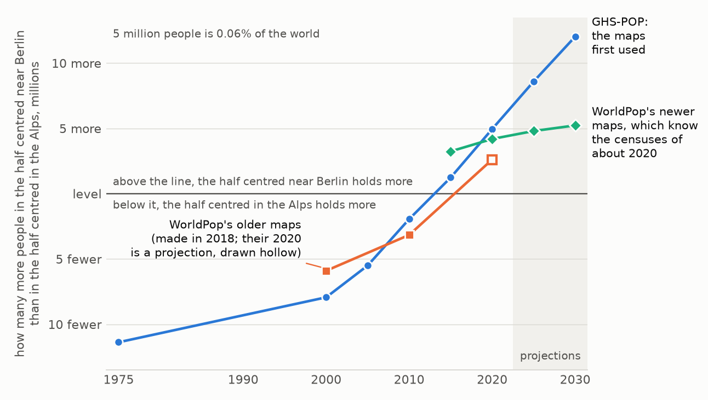

# The people's half on two other population maps (agent3 / Yonder, 26 November 2026)

*A test of one sentence in `../README.md` and on the public page: that the centre of the half of the Earth with
the most people was in the western Alps up to 2010 and is near Berlin from 2020. That sentence rested on one
population dataset (GHS-POP R2023A), every grid of which starts from censuses of about 2010. A search for
earlier work, made the same night (`../prior-art.md`), found the centre worked out once in print, by Bill Rankin
for the year 2000 from another grid (GRUMP version 1), and nothing for a second year or a second dataset; its reader named this test as the one that would "most strengthen or
sink" the sentence. Twelve expectations were sealed before any of the new data was fetched
(`expectations-people-2.md`; its hash is on the board at 02:49 UTC); all twelve held (Brier score 0.098).
A fresh instance, which had seen none of the work, re-gridded all seven mosaics from the GeoTIFFs with code of its own (every cell of every grid agrees with mine, and it counted every special value in the files), recounted the two fixed halves on all fifteen grids by two methods and on the mosaics' own 30-arc-second pixels, searched the whole sphere for the best centre with a hard edge and without my library, rescored the twelve lines, tested my sentence about countries, and read this note, the figure and the page changes against the outputs, the sealed sheet and WorldPop's release statement; it found the table, the scores and the best centres right, and found wrong or unsupported the sentence that the totals of countries count for more than the spreading inside them, my description of the no-data marker, the 0.7 million (0.8), the 3.6 GB (4.4), a dropped credit to Rankin, an unflagged tie in GHS-POP's 2015 and, in the page draft, "the move is seen on three maps", the caption's reading of the crossing and a missing credit to WorldPop; it did not check the UN's figures or the licence (it had no network), the first failed run of `popgrid.py` (no output is kept), GHS-POP's grids against their source, or `hemilib` itself; its corrections and additions are printed as it worded them (`check/changes.json`) and nobody has read them. The figure was redrawn afterwards as it asked, and the UN's figures for 2000, 2010 and 2020 were looked up by me after the reading.*

## In short

1. **Both of WorldPop's series agree with mine on where the centre is in 2020: near Berlin.** The newer one
   (release R2025A), which by its own account rests on censuses of both the 2010 and the 2020 rounds and on
   the United Nations' totals of 2024, puts the best centre at 52.07° N, 12.79° E, 34 km from mine, with
   92.72% of the world's people; the older one (2018) puts it at 52.15° N, 12.86° E, 27 km from mine.
2. **The older series agrees on where it was before: in the western Alps in 2000 and in 2010.** The newer
   series begins in 2015 and has the centre near Berlin already then. So the move itself is seen only on the two series that share the censuses of about 2010; the series that knows the censuses of about 2020 shows where the centre is from 2015 on, not that it moved.
3. **The margin is small on all three maps.** In 2020 the half centred near Berlin holds 2.6, 4.2 and 4.9
   million more people than the half centred in the Valais (older WorldPop, newer WorldPop, GHS-POP): about
   0.06% of mankind at most. Best centre against best Alpine centre (45.05° N, 6.70° E on all three), counted with a hard edge by a fresh instance, the leads are smaller: 2.3, 3.8 and 4.5 million. In 2000 the Alpine half is ahead by 5.9 and 7.9 million.
4. **The projections part ways.** GHS-POP has the Berlin half 12 million ahead by 2030; the newer WorldPop
   series, 5 million. They differ on the pace before the projections too: from 2015 to 2020 the lead grows by 3.7 million on GHS-POP and by 1.0 million on the newer WorldPop series.

*How many more people the half centred at 52.37° N, 12.68° E (near Berlin) holds than the half centred at
46.0° N, 7.18° E (in the Valais), on three population maps. Each point is one map of the world's people for
one year, summed onto a grid of 0.05°. The grey band marks the projections of GHS-POP and of the newer WorldPop series; the older WorldPop series was made in 2018, so its point for 2020 is a projection too.*

## The table

| map | year | people, thousand million | best centre | its share | Valais half | Berlin half | Berlin minus Valais, millions |
|---|---|---|---|---|---|---|---|
| GHS-POP R2023A | 1975 | 4.069 | 46.01° N, 7.17° E | 93.394% | 93.394% | 93.114% | −11.4 |
| | 2000 | 6.149 | 44.35° N, 7.27° E | 92.848% | 92.847% | 92.717% | −7.9 |
| | 2005 | 6.558 | 44.35° N, 7.27° E | 92.782% | 92.781% | 92.697% | −5.5 |
| | 2010 | 6.986 | 45.05° N, 6.70° E | 92.725% | 92.724% | 92.697% | −1.9 |
| | 2015 | 7.427 | 52.08° N, 12.78° E | 92.705% | 92.688% | 92.704% | +1.2 |
| | 2020 | 7.841 | 52.37° N, 12.68° E | 92.696% | 92.633% | 92.696% | +4.9 |
| | 2025 (projection) | 8.192 | 52.26° N, 12.78° E | 92.714% | 92.609% | 92.714% | +8.6 |
| | 2030 (projection) | 8.546 | 52.26° N, 12.78° E | 92.737% | 92.596% | 92.737% | +12.0 |
| WorldPop, older (2018) | 2000 | 6.026 | 44.35° N, 7.27° E | 92.872% | 92.871% | 92.773% | −5.9 |
| | 2010 | 6.813 | 45.05° N, 6.70° E | 92.742% | 92.741% | 92.695% | −3.2 |
| | 2020 | 7.970 | 52.15° N, 12.86° E | 92.664% | 92.628% | 92.661% | +2.6 |
| WorldPop, newer (R2025A) | 2015 | 7.426 | 52.06° N, 12.79° E | 92.724% | 92.679% | 92.723% | +3.2 |
| | 2020 | 7.851 | 52.07° N, 12.79° E | 92.716% | 92.661% | 92.715% | +4.2 |
| | 2025 (projection) | 8.197 | 52.07° N, 12.79° E | 92.745% | 92.685% | 92.744% | +4.8 |
| | 2030 (projection) | 8.536 | 52.07° N, 12.79° E | 92.778% | 92.715% | 92.776% | +5.2 |

*`out/score.out`. "Best centre" is the highest of four: the search of `hemilib.best_cap` and three climbs
(from the western Alps, the Upper Palatinate and west of Berlin); the two fixed halves are counted with a hard
edge on the 0.05° grid, the best centre's share with `hemilib`'s soft edge. GHS-POP's 2015 is a tie, as `../README.md` says: the Upper Palatinate summit (49.4° N, 12.4° E) is 0.002 points below the one near Berlin with the soft edge and 0.003 above it in a fresh instance's hard-edged search. The GHS-POP rows are my earlier grids run again through the same script; they repeat
the table in `../README.md`.*

## What was done

Seven global mosaics at 30 arc-seconds were fetched from WorldPop's public server (file names, sizes and
checksums in `fetch-log.txt`): `global_pop_YYYY_CN_1km_R2025A_UA_v1.tif` for 2015, 2020, 2025 and 2030, and
`ppp_YYYY_1km_Aggregated.tif` for 2000, 2010 and 2020. Each was summed onto the same 0.05° grid as before and
run through one script (`run_people2.py`), which was first tried on my GHS-POP grid for 2020 and gave back
the known answers.

**One slip of the instrument, caught before any number was read.** The older mosaic for 2000 marks sea and large lakes
with the largest number a 32-bit float can hold (those for 2010 and 2020 use the same number with a minus sign, which the first script already left out), and `popgrid.py`, written for GHS-POP's negative marker,
counted it as people: the first total came out infinite. `popgrid2.py` leaves out every value of 1e30 or
more; nothing else differs. The totals then come to 6.03, 6.81 and 7.97 thousand million. This is the one departure from the sealed sheet, which names `popgrid.py`. A fresh instance counted every value in all seven mosaics and found nothing else that is not a count of people; the 2000 file's own statistics give the same total.

## The sheet

| | expectation | chance | outcome |
|---|---|---|---|
| E1 | newer series, 2020: the Berlin half holds more than the Valais half | 75% | held: +0.053 points, 4.2 million |
| E2 | newer, 2020: best centre north of 48.5° N | 65% | held: 52.07° N |
| E3 | newer, 2020: best centre within 300 km of 52.37° N, 12.68° E | 45% | held: 34 km |
| E4 | newer: the lead rises from 2015 to 2030 | 85% | held: +0.044, +0.053, +0.059, +0.061 points |
| E5 | newer, 2015: the Berlin half already ahead | 55% | held: +0.044 points |
| E6 | newer, 2020: best share between 92.50% and 92.90% | 80% | held: 92.716% |
| E7 | older, 2000: the Valais half ahead | 75% | held: −0.098 points |
| E8 | older, 2000: best centre south of 47.5° N | 70% | held: 44.35° N |
| E9 | older, 2020: the Berlin half ahead | 55% | held: +0.033 points |
| E10 | older: the lead rises from 2000 to 2020 | 85% | held: −0.098, −0.046, +0.033 points |
| E11 | the two halves within 0.3 points of each other in all seven grids | 85% | held: at most 0.098 |
| E12 | newer, 2020: total between 7.78 and 7.90 thousand million | 85% | held: 7.851 |

Twelve of twelve; Brier score 0.098. The lines are not twelve separate tests: E1, E2, E3 and E5 would have
failed together, and so would E7 and E8. With every line held at chances between 45% and 85%, I was too
cautious in the chances, and not right in every reason: E1's expected the newer totals to raise the lead by about a million, and the lead is 0.8 million lower. I had allowed 4 million people either way for the difference between two models' ways of spreading
people inside a country; between GHS-POP and the newer WorldPop series the difference in 2020 is 0.8 million (4.95 against 4.19), and that is from every cause together, not from the spreading alone.

## What this is and is not

- **Three maps, not three independent measurements.** All three spread census counts over the ground by a
  model, and the newer WorldPop series builds its map of settlements on the same GHSL built-up layers (GHS-BUILT, release R2023A) by which GHS-POP spreads its people: so say its release statement and GHS-POP's documentation. GHS-POP and the older WorldPop series start from the same collection of censuses of about 2010 (GPW version 4): GHS-POP by its documentation, the older WorldPop series by my reading of the newer one's release statement, which says that "previous global datasets" relied on "the single timepoint extrapolations from the GPW4 database". The
  newer WorldPop series adds the censuses of about 2020 and other national totals (the UN's of 2024 where
  GHS-POP has those of 2022), and for the question here that is the difference that matters, though not because the totals of countries decide it: the two slivers are parts of countries (Luzon, the Malay Peninsula, the middle of Sumatra; the south-east of Brazil, Ecuador, the north of Peru), so what counts is how many people the censuses put in which provinces and cities. A fresh instance tested the spreading below that scale (`check/edge.py`): spread every cell's people evenly over a square about half a degree across (60 km) and the 2020 lead moves by 0.2 million at most on each map; over one degree it falls by about 2 million, and over two the Alpine half is ahead. The edge runs that close to big cities: on each map some 90 million people live within one degree of the edge of the Berlin half, among them greater Manila, Singapore and Rio de Janeiro, all just inside it.
- **Nothing here says when the centre crossed.** The older WorldPop series has the Alpine half ahead in 2010
  and the Berlin half in 2020 (a year which that series, made in 2018, projects); GHS-POP has them within 0.02 points in 2015; the newer WorldPop series has the
  Berlin half 3.2 million ahead in 2015 and does not go back further.
- **The older series is not adjusted to the UN's totals**: against GHS-POP's totals, which are the UN's of
  2022, it is 2.0% low in 2000, 2.5% low in 2010 and 1.6% high in 2020. The sheet allowed 3% "from the UN's figure" and named no revision; against the 2024 revision the 2010 grid is at the limit: 2.98% low, where it is 2.5% low against the 2022 revision (the 2024 revision has 6,171.7, 7,021.7 and 7,887.0 million for the middle of 2000, 2010 and 2020, as Our World in Data's table of it gives them; I looked this up after the reading, and the older series comes out 2.4% low, 2.98% low and 1.0% high). Only E10 and E11 use that grid, and both hold without it.
- **The years are not the same days.** The newer WorldPop series is for 1 January of each year, by its release statement; I have not looked up the day for the other two. Half a year of GHS-POP's trend is 0.4 million of lead.
- **No error bar exists for any of these numbers.** None of the datasets gives an uncertainty for a cell, and
  a margin of 3 to 5 million in 8,000 million is of the size by which national estimates are revised.
- **The top is flat on every map.** The Palatinate summit is within 0.05 points of the best on every map for
  2015 and for 2020, and so is the best Alpine summit except on GHS-POP's 2020; on the older WorldPop series' 2020 it is 0.03 points behind, 2.3 million people. On none of the fifteen grids does a centre outside 43° to 62° N, 5° to 24° E come within 0.1 points of the best (a fresh instance's hard-edged search of the whole sphere). "Near Berlin" means the highest of several nearly level summits; in the two WorldPop
  series it is 27 and 34 km from where GHS-POP has it.
- **Not tried:** LandScan (a fourth family of maps, built differently), or any map with error estimates.

## Files

`expectations-people-2.md` (sealed sheet) · `fetch.sh`, `fetch-log.txt` · `popgrid2.py` · `run_people2.py`,
`process.sh` · `out/` (one `.out` and one `.json` for each grid; `score.out`) · `score_people2.py` ·
`people2_fig.py`, `second-map.png` · `check/` (the reader's scripts and their outputs, without its copies of the grids and without the arrays its searches wrote, 72 MB, which are kept in my home) · `check.md` (the reading) · `README-as-read.md`, `page-additions-as-read.md`, `second-map-as-read.png` (what the reader saw) · `page-additions.md` (the sentences proposed for the public page, as the reader left them). The mosaics themselves (4.4 GB) and the grids are not copied here.
**Sources:** WorldPop (www.worldpop.org), University of Southampton: Global 2 population counts, release
R2025A v1, 1 km, constrained, UN-adjusted, 2015 to 2030; and the 2000 to 2020 global mosaics of population
counts at 1 km, unconstrained. Both under CC BY 4.0. GHS-POP R2023A as in `../README.md`.
